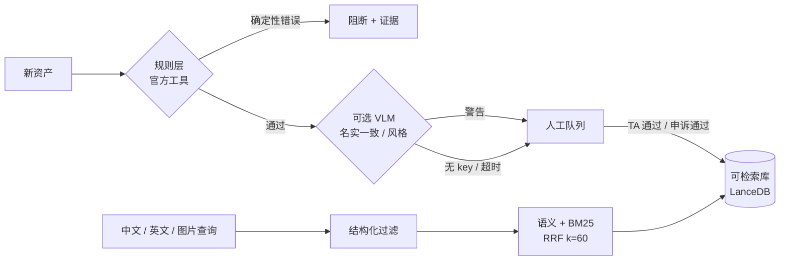

<div align="center">

# 🗃️ ArtGate · 游戏美术资产语义检索与入库预检

*Early prototype: hybrid semantic + lexical search and rule-based pre-checks for game art assets.*


</div>

> [!IMPORTANT]
> **本仓库已由 [ieg-artpipe](https://github.com/felix6328/ieg-artpipe) 取代**，保留作过程记录。ArtPipe 改用开源游戏 0 A.D. 的真实资产和开发历史做评测，后续更新都在那边。

> [!NOTE]
> 个人求职作品（方向：腾讯 IEG · 游戏管理平台产品），**不是**腾讯或任何游戏项目组的生产系统，与腾讯无官方关联。评测资产全部来自公开许可（Kenney CC0、Poly Haven CC0、Khronos 按模型各自许可）。

**产品观：** 能用工具算死的，不交给模型；模型只做规则写不死的视觉判断，并且**默认不阻断生产**。通过或申诉通过后，资产才进入可检索库。

---

## 📑 目录

[背景](#-背景) · [功能](#-功能) · [流程](#-流程) · [实测数字](#-实测数字) · [快速开始](#-快速开始) · [目录结构](#-目录结构) · [取舍与局限](#-取舍与局限) · [FAQ](#-faq) · [许可](#-许可)

---

## 🧩 背景

| | |
|---|---|
| **痛点** | 已有资产找不到（文件名搜不到中文意图）；入库规范靠人工抽查 |
| **判断** | 共性规范做成**可按项目切换的 YAML 模板**；数值检查只信官方工具；视觉判断交给可选 VLM 且只警告 |
| **成本** | 嵌入本地计算、按文件哈希缓存，**API 费用 0**；VLM 仅对启用视觉项的资产传缩略图 |
| **安全边界** | 确定性错误才阻断；校验器 warning 不升为 block；VLM 超时或低置信降级为仅规则；**禁止自动删除或自动驳回** |

## ✨ 功能

| 模块 | 说明 |
|---|---|
| 🔍 检索（v2 默认） | 中 / 英自然语言 + 以图搜图；先结构化过滤，再 **OpenCLIP 语义 + BM25 词法 RRF 融合**，词法一路带中文游戏美术同义词扩展；`retriever=semantic` 复现 v1 |
| 🚦 入库预检 | 命名、格式、体积、2 的幂次、面数预算、glTF 规范（Khronos glTF-Validator / glTF-Transform）；可选 VLM 只判断「文件名与画面是否一致」「是否偏离风格参考」 |
| 🧩 平台化 | 引擎一套、规范是模板：模板 M 模拟风格化手游低模（Kenney），模板 R 模拟写实项目（Poly Haven） |
| 👤 人在回路 | 预检结果进人工队列，TA 通过后才入可检索库 |

## 🔄 流程



## 📊 实测数字

> 2026-11-13，Linux x86_64 · 8 核 · 仅 CPU。**检索金标由脚本自动起草，尚未经人工审阅**（见 [eval/GOLD_QUERIES_README.md](eval/GOLD_QUERIES_README.md)）；v2 未改金标。

| 系统（87 条文本查询） | Recall@10 | nDCG@10 | 中文 R@10 | 英文 R@10 | P95 时延 |
|---|---:|---:|---:|---:|---:|
| 文件名基线 | 0.5195 | 0.5435 | 0.3355 | 0.8206 | — |
| v1 语义 | 0.6086 | 0.5824 | 0.5548 | 0.6967 | 76.78 ms |
| BM25 + 扩展（消融） | 0.7629 | 0.8004 | 0.7338 | 0.8105 | 19.25 ms |
| **v2 混合** | **0.8248** | **0.8190** | **0.7973** | **0.8699** | 86.31 ms |

- 17 条查询从 Recall@10=0 变为有召回（「一把剑」「圆形盾牌」`a sword`…），**0 条回退到 0**。
- RRF 的真实代价：「长方形盾牌」「男性角色」BM25 单独为 1.0、混合后仍为 0——看完结果后没有回改融合规则。
- 规则层：18 条注入样本上各检查项 P/R 1.00，误拦 0/9，漏放 0/8（**样本量小，不能外推**）；单资产预检 P95 198.72 ms。
- 视觉层（VLM）：**未测**。

详见 [eval/results.md](eval/results.md)（v1）· [eval/results_v2.md](eval/results_v2.md)（v2）· [eval/badcases.md](eval/badcases.md)。

## 🚀 快速开始

```bash
git clone https://github.com/felix6328/artgate.git && cd artgate
python3 -m venv .venv && source .venv/bin/activate
pip install torch torchvision --index-url https://download.pytorch.org/whl/cpu
pip install -r requirements.txt
npm install                                   # gltf-validator 与 @gltf-transform/cli（可选）
export PYTHONPATH=$PWD HF_HOME=$PWD/.cache/huggingface

python -m pytest tests -q                     # 规则与混合检索单元测试
```

<details>
<summary><b>完整流程：下载资产 → 入库 → 评测 → 工作台</b></summary>

```bash
python scripts/download_data.py               # Kenney 子集、Poly Haven 1K、Khronos 样本 + 许可清单
python scripts/create_broken_assets.py        # 故意损坏的预检夹具与金标
python scripts/build_library.py               # 入库、预览、预检、嵌入索引
python scripts/generate_gold.py               # 自动起草检索金标（需人工审阅）
python eval/measure.py                        # v1 评测
python scripts/run_eval_v2.py                 # v2 对比评测
python scripts/prepare_demo_queue.py
./scripts/run_app.sh                          # http://127.0.0.1:8765
```

模型加载后进程 RSS 约 2.2 GB，建议 8 GB 以上内存。没有 Node 时规则层降级到 Python 回退，并在报告中标明。

</details>

## 🗂️ 目录结构

```text
artgate/
├── artgate/
│   ├── ingest/          # 入库
│   ├── precheck/        # 规则引擎、官方工具封装、可选 VLM
│   ├── search/          # 嵌入、BM25、同义词扩展、RRF 混合
│   └── review/          # 人工队列
├── app/                 # FastAPI 工作台
├── configs/             # settings、同义词表、项目规范模板 M / R
├── data/                # 损坏夹具、目录与许可清单（下载资产不入库）
├── eval/                # 金标、评测脚本与结果
├── scripts/             # 下载、建库、评测、启动
├── tests/               # pytest
└── docs/                # PRD · DEMO · COST
```

## ⚖️ 取舍与局限

| 取舍 | 原因 |
|---|---|
| 工作流而非自主 Agent | 预检步骤固定，可解释比「聪明」重要 |
| 数值只来自官方工具 | 不让模型「估」面数和尺寸 |
| 同义词表写于 v1 坏例之后 | **存在泄漏风险**；用 dev/test 事后检验缓解（v2 R@10：dev 0.7817，test 0.8670） |

- 检索金标未经人工审阅；预检金标只有 18 条。
- 3D 预览为自渲，非引擎截图；风格只覆盖卡通低模与写实，不能代表二次元或像素风。
- 没有真实项目组访谈和线上点击率 / 申诉率；未测真实 VLM。

## ❓ FAQ

<details>
<summary><b>为什么被 ieg-artpipe 取代？</b></summary>

ArtGate 的评测资产是 CC0 素材 + 人工注入的错误，无法说明真实项目里问题有多常见。ArtPipe 改用 0 A.D. 的真实资产与 20 年开发历史，能用真实 Issue 回放验证规则价值。
</details>

<details>
<summary><b>以图搜图 Recall@10 = 1.0 可信吗？</b></summary>

偏乐观：查询图是库内预览图，只有 8 条，仅说明链路可用。
</details>

## 📄 许可

- 代码：[MIT](LICENSE)，© 2026 felix6328。
- 资产：Kenney CC0（经 [shorepine/kenney](https://github.com/shorepine/kenney) 再分发仓库获取并记录 commit）、Poly Haven CC0、Khronos glTF-Sample-Assets 按模型各自许可。详见 [data/licenses.md](data/licenses.md)。
- 开源组件：OpenCLIP（MIT）、LanceDB（Apache-2.0）、glTF-Validator（Apache-2.0）、glTF-Transform（MIT）。
